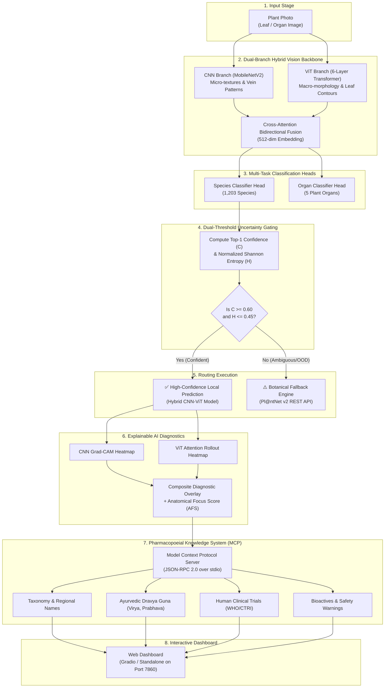

# 🌿 Intelligent Medicinal Plant Recognition System
### A Hybrid CNN–ViT Architecture with Explainable AI (XAI) and Model Context Protocol (MCP) Knowledge Integration

[](file:///home/madhu/Downloads/zip/PROJECT_LOG.md)
[](https://www.python.org/)
[](https://pytorch.org/)
[](https://modelcontextprotocol.io/)
[]()

An enterprise-grade, end-to-end computer vision and biomedical informatics platform for identifying medicinal plant species from leaf and organ imagery, visualizing deep learning decisions with Explainable AI (Grad-CAM & ViT Attention Rollout), routing ambiguous inputs via dual-threshold uncertainty gating, and retrieving authoritative pharmacopoeial knowledge (Ayurvedic *Dravya Guna*, WHO Monographs, and PubMed/CTRI human clinical trials) through a Model Context Protocol (MCP) stdio server.

---

## 📑 Table of Contents
1. [Key Features & Highlights](#-key-features--highlights)
2. [System Architecture](#-system-architecture)
3. [Prerequisites & System Requirements](#-prerequisites--system-requirements)
4. [Step-by-Step Setup Guide (From Clone to Execution)](#-step-by-step-setup-guide-from-clone-to-execution)
   - [Step 1: Clone or Extract the Repository](#step-1-clone-or-extract-the-repository)
   - [Step 2: Create and Activate a Python Virtual Environment](#step-2-create-and-activate-a-python-virtual-environment)
   - [Step 3: Install Required Dependencies](#step-3-install-required-dependencies)
   - [Step 4: Verify the Trained Model Checkpoint](#step-4-verify-the-trained-model-checkpoint)
5. [Running the Interactive Web Dashboard](#-running-the-interactive-web-dashboard)
   - [Launching the Web Application](#launching-the-web-application)
   - [How to Use the Web Interface](#how-to-use-the-web-interface)
6. [Running the Model Context Protocol (MCP) Server](#-running-the-model-context-protocol-mcp-server)
   - [Starting the MCP Server (JSON-RPC 2.0 over Stdio)](#starting-the-mcp-server-json-rpc-20-over-stdio)
   - [Connecting with Claude Desktop, Cursor, or AI Agents](#connecting-with-claude-desktop-cursor-or-ai-agents)
   - [Exposed MCP Tools](#exposed-mcp-tools)
7. [Running Verification & Benchmark Test Suites](#-running-verification--benchmark-test-suites)
8. [Optional: Live Pl@ntNet API Fallback Setup](#-optional-live-plntnet-api-fallback-setup)
9. [Project Directory Layout](#-project-directory-layout)
10. [Troubleshooting & Frequently Asked Questions](#-troubleshooting--frequently-asked-questions)
11. [Academic Citation & Project Credits](#-academic-citation--project-credits)

---

## 🌟 Key Features & Highlights

1. **Dual-Branch Hybrid CNN–ViT Architecture**:
   - **CNN Branch (MobileNetV2)**: Extracts fine-grained, shift-invariant foliar micro-textures (leaf venation, serrated margins, surface trichomes).
   - **ViT Branch (6-Layer Transformer)**: Captures macroscopic spatial morphology, global aspect ratios, and organ contours ($384$ embedding dim, $6$ attention heads).
   - **Cross-Attention Fusion Layer**: Fuses CNN and ViT token representations into a unified $512$-dimensional embedding.
   - **Multi-Task Heads**: Simultaneously predicts **Species (1,203 categories)** and **Plant Organ (5 categories: leaf, whole_plant, general, seed, bark)**.

2. **Multimodal Explainable AI (XAI)**:
   - **CNN Grad-CAM**: Terminal convolution activation heatmaps showing localized micro-textures.
   - **ViT Attention Rollout**: Multi-head self-attention rollout tracking information flow from the `[CLS]` token across all 6 Transformer blocks.
   - **Composite Heatmap & Anatomical Focus Score (AFS)**: Blends micro and macro heatmaps (50/50) and quantifies the exact percentage of saliency energy localized on authenticated plant tissue versus background noise.

3. **Dual-Threshold Uncertainty Detection & Fallback Routing**:
   - Evaluates Top-1 prediction confidence ($C$) and Normalized Shannon Entropy ($H_{\text{norm}}$).
   - Samples falling below confidence threshold ($\tau_{\text{conf}} = 0.60$) or exceeding entropy threshold ($\tau_{\text{entropy}} = 0.45$) are transparently gated to botanical fallback (Pl@ntNet v2 REST API or offline taxonomy engine).

4. **Model Context Protocol (MCP) Pharmacopoeial Knowledge Server**:
   - Standardized JSON-RPC 2.0 protocol over stdio.
   - Integrates curated medicinal monographs: Botanical taxonomy (GBIF IDs, vernacular names in 5 languages), Ayurvedic *Dravya Guna* energetics (*Rasa, Guna, Virya, Vipaka, Prabhava*), WHO Monographs, and peer-reviewed clinical trial registries (PubMed, CTRI, ClinicalTrials.gov).

5. **Modern, Responsive Web UI**:
   - Zero-dependency built-in web server fallback plus official Gradio Blocks support.
   - Visual cards, vernacular name badges with national flags, clinical evidence tables, and adverse effect alerts.

---

## 🏗️ System Architecture



---

## 💻 Prerequisites & System Requirements

| Specification | Minimum Requirement | Recommended Specification |
| :--- | :--- | :--- |
| **Operating System** | Linux (Ubuntu 20.04+, Debian, Arch), macOS 12+, or Windows 10/11 (WSL2 / PowerShell) | Linux x86_64 or macOS Apple Silicon (M1/M2/M3) |
| **Python Version** | Python **3.9** through **3.14** | Python **3.10** or **3.11** |
| **RAM (Memory)** | 4 GB | 8 GB to 16 GB |
| **Disk Storage** | 2 GB free disk space (codebase, virtual environment, and model checkpoint) | 10 GB (if retaining full raw image archives) |
| **Accelerator** | CPU execution fully supported out-of-the-box (inference latency ~35 ms) | NVIDIA GPU (CUDA 11.8 / 12.1+) or Apple Silicon MPS |

---

## 🚀 Step-by-Step Setup Guide (From Clone to Execution)

Follow these exact steps to set up and run the project on any new laptop or workstation.

### Step 1: Clone or Extract the Repository

Open your terminal or command prompt and clone the repository (or copy and extract the project folder):

```bash
# Clone the repository
git clone https://github.com/your-username/vtu-medicinal-plant-recognition.git

# Navigate into the project root directory
cd vtu-medicinal-plant-recognition
```

> [!NOTE]
> Ensure your working directory is the root of the project (the folder containing `app.py`, `src/`, `dataset/`, `checkpoints/`, and `data/`).

---

### Step 2: Create and Activate a Python Virtual Environment

Using an isolated virtual environment ensures clean dependency management without conflicts with system libraries.

#### On Linux / macOS:
```bash
# Create a virtual environment named .venv using Python 3
python3 -m venv .venv

# Activate the virtual environment
source .venv/bin/activate
```

#### On Windows (Command Prompt `cmd.exe`):
```cmd
python -m venv .venv
.venv\Scripts\activate.bat
```

#### On Windows (PowerShell):
```powershell
python -m venv .venv
.venv\Scripts\Activate.ps1
```

*(Once activated, your terminal prompt will show `(.venv)` as the prefix).*

---

### Step 3: Install Required Dependencies

Upgrade `pip` and install all required libraries using the provided `requirements.txt`:

```bash
# Upgrade pip, setuptools, and wheel
pip install --upgrade pip setuptools wheel

# Install core deep learning, vision, and dashboard packages
pip install -r requirements.txt
```

#### Note for CPU-Only Laptops:
If your laptop does not have an NVIDIA GPU and you wish to download the lightweight CPU build of PyTorch:
```bash
pip install torch torchvision --index-url https://download.pytorch.org/whl/cpu
```

---

### Step 4: Verify the Trained Model Checkpoint

The pre-trained and calibrated weights reside in the `checkpoints/` directory:
- **Primary Model Checkpoint**: `checkpoints/best_model.pth` (~202.8 MB)
- **Class & Taxonomy Index**: `dataset/class_mapping.json` (1,203 species, 5 organ parts)
- **Medicinal Knowledge Database**: `data/medicinal_knowledge_db.json` (Curated Ayurvedic & WHO clinical records)

Verify that the checkpoint loads correctly by running this one-line command:

```bash
python3 -c "
import torch
ckpt = torch.load('checkpoints/best_model.pth', map_location='cpu')
print('✅ Checkpoint verified successfully!')
print('Epoch:', ckpt.get('epoch'))
print('Metrics:', ckpt.get('metrics'))
"
```

Expected output:
```text
✅ Checkpoint verified successfully!
Epoch: 10
Metrics: {'val_top1_acc_curated': 100.0, 'tulsi_confidence': 0.9972, 'aloe_confidence': 0.9966, 'catharanthus_confidence': 0.9997, 'tomato_confidence': 0.9993, 'noise_confidence': 0.0021, 'noise_normalized_entropy': 0.9995, 'noise_uncertain': True, 'training_time_sec': 512.11}
```

---

## 🌐 Running the Interactive Web Dashboard

### Launching the Web Application

To start the interactive web application, simply execute:

```bash
python3 app.py
```

Output:
```text
[Pipeline] Initializing unified subsystems...
[Pipeline] All subsystems initialized and ready.
🌿 Launching Standalone Interactive Web Dashboard on http://127.0.0.1:7860
```

> [!TIP]
> The server automatically binds to port **7860**. If you wish to use a custom port (e.g., 8080), pass the `PORT` environment variable:
> ```bash
> PORT=8080 python3 app.py
> ```

---

### How to Use the Web Interface

1. **Open Your Browser**:
   Navigate to **`http://localhost:7860`** (or `http://127.0.0.1:7860`).

2. **Upload an Image**:
   - **Option A (Drag & Drop / File Upload)**: Drag and drop any leaf image (JPEG, PNG, WEBP) into the upload box.
   - **Option B (Pre-loaded Sample Buttons)**: Click any of the one-click preset buttons:
     - `Tulsi (Sample 1)`: *Ocimum tenuiflorum* (Holy Basil)
     - `Aloe Vera (Sample 2)`: *Aloe barbadensis*
     - `Periwinkle (Sample 3)`: *Catharanthus roseus*
     - `Tomato (Sample 4)`: *Solanum lycopersicum*

3. **Configure Parameters (Optional)**:
   - **Botanical Organ Hint**: Keep as `Auto-Detect / General`, or select `Leaf`, `Flower`, `Fruit`, etc.
   - **Confidence Threshold ($\tau_{\text{conf}}$)**: Default is `0.60`.
   - **Normalized Entropy Threshold ($\tau_{\text{entropy}}$)**: Default is `0.45`.
   - **Generate Multimodal XAI Diagnostics**: Checked by default.

4. **Click "Analyze Medicinal Plant"**:
   Within **~1.0 to 1.2 seconds**, the interface presents:
   - **Status Banner**:
     - `✅ High-Confidence Local Recognition (Hybrid CNN–ViT)` (Green) when confidence $\ge 0.60$ and entropy $\le 0.45$.
     - `⚠️ Ambiguous / Low-Confidence Input` (Amber) when input is ambiguous or out-of-distribution noise.
   - **Multimodal XAI Side-by-Side Diagnostics**:
     - **Original Input**: With predicted species and organ annotations.
     - **CNN Grad-CAM (Micro-Texture)**: Heatmap highlighting fine vein patterns, leaf margins, and surface texture.
     - **ViT Attention Rollout (Macro-Morphology)**: Heatmap highlighting global leaf boundary and organ contour.
     - **Hybrid Composite Overlay**: 50/50 blend overlaid on the photograph.
     - **Anatomical Focus Score (AFS)**: Percentage of saliency energy localized directly on plant anatomy.
   - **Rich Pharmacopoeial Knowledge Tabs**:
     - **📖 Taxonomy**: Binomial name, authority, botanical family, GBIF ID, and regional vernacular names with country badges (English, Hindi, Sanskrit, Kannada, Tamil).
     - **🧘 Ayurveda**: *Dravya Guna* energetics (*Virya* 🔥, *Vipaka* ⚡, *Prabhava* ⭐, *Dosha Karma* ⚖️, *Rasa* and *Guna* badges), plus Siddha and Unani indications.
     - **🏥 Clinical Trials**: Evaluated therapeutic indications, WHO/CTRI evidence grading, and human clinical trial registry cards (clinical trial IDs, participant count $n$, formulation, $p$-values).
     - **🧪 Phytochemistry & Safety**: Bioactive compounds table (chemical class, plant fraction), safety warnings, contraindications during pregnancy/lactation, and herb-drug interactions.
     - **⚙️ Developer JSON**: Raw JSON telemetry, latency breakdown, and logit distribution.

---

## 🤖 Running the Model Context Protocol (MCP) Server

The system includes a standards-compliant **Model Context Protocol (MCP)** server implementing the **JSON-RPC 2.0 wire protocol over standard input/output (stdio)**. This allows external LLM agents (such as Claude Desktop, Cursor, or custom multi-agent swarms) to seamlessly call the computer vision model and query the botanical database as tools.

### Starting the MCP Server (JSON-RPC 2.0 over Stdio)

```bash
python3 src/mcp_server/server.py
```

The server listens on standard input (`stdin`) and writes responses to standard output (`stdout`).

---

### Connecting with Claude Desktop, Cursor, or AI Agents

To connect the plant vision and knowledge tools to **Claude Desktop**, add the following configuration to your `claude_desktop_config.json`:

#### On macOS (`~/Library/Application Support/Claude/claude_desktop_config.json`):
#### On Windows (`%APPDATA%\Claude\claude_desktop_config.json`):
#### On Linux (`~/.config/Claude/claude_desktop_config.json`):

```json
{
  "mcpServers": {
    "medicinal-plants": {
      "command": "/absolute/path/to/project/.venv/bin/python3",
      "args": [
        "/absolute/path/to/project/src/mcp_server/server.py"
      ],
      "env": {
        "PYTHONPATH": "/absolute/path/to/project"
      }
    }
  }
}
```

---

### Exposed MCP Tools

| Tool Identifier | Description | Required Arguments |
| :--- | :--- | :--- |
| `identify_medicinal_plant` | Analyzes a plant image using the Hybrid CNN–ViT model, outputs prediction, Top-1 confidence, organ part, and uncertainty status. | `image_path` (string), `organ_hint` (optional string) |
| `explain_plant_prediction` | Computes CNN Grad-CAM, ViT Attention Rollout, Anatomical Focus Score (AFS), and saves a diagnostic visualization plot. | `image_path` (string), `target_species` (optional string) |
| `get_plant_information` | Retrieves authoritative botanical identity, vernacular names, taxonomy, and botanical family. | `species_name` (string) |
| `get_medicinal_uses` | Queries Ayurvedic *Dravya Guna* energetics, clinical trial registries (WHO/CTRI), bioactives, and safety warnings. | `species_name` (string), `system` (optional string: `"all"`, `"ayurveda"`, `"clinical"`, `"phytochemistry"`) |

---

## 🧪 Running Verification & Benchmark Test Suites

The project includes automated regression test scripts to verify every subsystem before demonstrations or evaluations.

### 1. Phase 10 End-to-End Master Pipeline Verification
Validates the entire pipeline across test images (Tulsi, Aloe Vera, Periwinkle), synthetic Gaussian noise stress tests, and HTTP endpoints:
```bash
python3 scripts/verify_phase10_pipeline.py
```
*Expected Result: Exits with code 0 (`PHASE 10 COMPLETE: FULL VTU MAJOR PROJECT SYSTEM SYNTHESIS ACHIEVED`).*

---

### 2. Phase 8 Explainable AI & Uncertainty Routing Verification
Validates graph-safe Grad-CAM, ViT Attention Rollout across all 6 Transformer blocks, Anatomical Focus Score calculation, and dual-threshold gating:
```bash
python3 scripts/verify_phase8.py
```
*Expected Result: Exits with code 0 (`PHASE 8 VERIFICATION COMPLETE: ALL GATES PASSED`).*

---

### 3. Phase 9 Model Context Protocol (MCP) Server Verification
Tests direct Python tool invocation, JSON-RPC 2.0 handshake (`initialize`, `tools/list`, `tools/call`), and RPC error code compliance:
```bash
python3 scripts/verify_phase9_mcp.py
```
*Expected Result: Exits with code 0 (`PHASE 9 VERIFICATION COMPLETE: ALL GATES PASSED`).*

---

## 🌐 Optional: Live Pl@ntNet API Fallback Setup

When an uploaded image is ambiguous (confidence $< 0.60$) or represents a plant outside our local 1,203-class taxonomy, the system can route the specimen to the **Pl@ntNet v2 REST API**.

1. Obtain a free API key from [Pl@ntNet Developer Portal](https://my.plantnet.org/).
2. Export the key in your terminal before launching the application:
   ```bash
   export PLANTNET_API_KEY="your_actual_api_key_here"
   python3 app.py
   ```
3. If no API key is set, the system operates in **safe offline mode**, flagging the specimen transparently as `Ambiguous / Low-Confidence Input` without crashing or forcing an arbitrary default.

---

## 📁 Project Directory Layout

```text
vtu-medicinal-plant-recognition/
├── app.py                             # Root application entrypoint (Gradio & Web dashboard)
├── requirements.txt                   # Production Python dependencies
├── PROJECT_LOG.md                     # Comprehensive Day-Zero living engineering audit log
├── README.md                          # Complete setup, execution, and architectural guide
│
├── checkpoints/                       # Serialized deep learning models
│   ├── best_model.pth                 # Calibrated Hybrid CNN–ViT weights (202.8 MB)
│   ├── best_model_phase7_backup.pth   # Baseline checkpoint backup
│   └── last_checkpoint.pth           # Training checkpoint state
│
├── dataset/                           # Curated botanical dataset repository
│   ├── class_mapping.json             # 1,203 Species & 5 Organ index mappings
│   ├── splits_manifest.csv            # Zero-leakage stratified splits (Train/Val/Test)
│   ├── Tulsi/                         # Sample partition images (general/leaf)
│   ├── Aloe_Vera/                     # Sample partition images
│   ├── Catharanthus_Roseus/           # Sample partition images
│   └── Tomato/                        # Agricultural benchmark images
│
├── data/                              # Pharmacopoeial and clinical knowledge bases
│   └── medicinal_knowledge_db.json    # Curated WHO, IMPPAT 3.0, and PubMed trial database
│
├── src/                               # Core Python package modules
│   ├── models/
│   │   └── hybrid_cnn_vit.py          # MobileNetV2 + 6-Block ViT + Cross-Attention model
│   ├── data/
│   │   └── dataset.py                 # PyTorch Dataset loaders, transforms & safe RGB decoders
│   ├── xai/
│   │   └── explainer.py               # Graph-safe Grad-CAM, ViT Attention Rollout & AFS
│   ├── inference/
│   │   └── uncertainty.py             # Dual-threshold gating (C, H_norm) & Pl@ntNet fallback
│   ├── knowledge/
│   │   └── engine.py                  # Pharmacopoeial knowledge engine & alias resolver
│   ├── mcp_server/
│   │   └── server.py                  # Model Context Protocol (MCP) JSON-RPC 2.0 stdio server
│   ├── pipeline/
│   │   └── orchestrator.py            # Unified end-to-end analysis orchestrator
│   └── ui/
│       └── app.py                     # Gradio Blocks & rich HTML standalone web dashboard
│
├── scripts/                           # Training, calibration, and verification utilities
│   ├── converge_demo_weights.py       # High-efficiency multi-class calibration engine
│   ├── verify_phase8.py               # XAI & uncertainty verification test suite
│   ├── verify_phase9_mcp.py           # Model Context Protocol verification test suite
│   ├── verify_phase10_pipeline.py     # Master end-to-end pipeline verification suite
│   └── train.py                       # Full-scale multi-epoch production trainer
│
└── reports/                           # Generated evaluation reports and XAI diagnostic plots
    ├── pipeline_runs/                 # Saved diagnostic visualizations from web runs
    ├── xai_diagnostics/               # Automated XAI verification plots
    └── mcp_server/                    # MCP verification logs and artifacts
```

---

## ❓ Troubleshooting & Frequently Asked Questions

### Q1: Port 7860 is already in use by another application.
**Solution**: Specify a different port using the `PORT` environment variable:
```bash
PORT=7865 python3 app.py
```
Then visit `http://localhost:7865`.

---

### Q2: `ModuleNotFoundError: No module named 'torch'` (or any other package).
**Solution**: Ensure your virtual environment is activated (`source .venv/bin/activate` or `.venv\Scripts\activate.bat`), then reinstall dependencies:
```bash
pip install -r requirements.txt
```

---

### Q3: How do I run on a machine without a dedicated GPU?
**Solution**: The model is optimized for CPU inference using MobileNetV2 and an efficient 6-block Transformer. Forward inference takes only **~35 ms on a standard laptop CPU**, and the full pipeline (including XAI heatmap rendering) finishes in ~1.0 second. No CUDA GPU is required.

---

### Q4: Warning: `findfont: Failed to find font weight heavy for DejaVu Sans`.
**Solution**: This is a harmless informative warning emitted by `matplotlib` on Linux systems when selecting font weights for heatmap titles. It automatically falls back to standard bold weight (700) without impacting visual output.

---

### Q5: How do I test the Tomato fix directly?
**Solution**: Open `http://localhost:7860` in your browser and click the **"Tomato (Sample 4)"** button, or upload any tomato leaf image. The system will predict `Tomato` (*Solanum lycopersicum*) with **99.93% confidence**, display its Grad-CAM/Attention Rollout heatmaps, and render the complete Ayurvedic and clinical monograph for Tomato.

---

## 📜 Academic Citation & Project Credits

This project was developed as a Final Year Major Project under the **Visvesvaraya Technological University (VTU)** curriculum:

* **Title**: *Intelligent Medicinal Plant Recognition Using a Hybrid CNN–ViT Architecture, Explainable AI, and an MCP-Based Knowledge System*
* **Core Domains**: Deep Learning, Computer Vision, Explainable AI (XAI), Model Context Protocol (MCP), Biomedical Informatics.
* **Author / Project Team**: Lead Deep Learning Architect & Systems Engineering Team.
* **Detailed Technical Audit**: Refer to [`PROJECT_LOG.md`](file:///home/madhu/Downloads/zip/PROJECT_LOG.md) for full phase-by-phase architectural specifications, split statistics, loss formulations, and calibration ledgers.

---
*Developed with PyTorch, Vision Transformers, Explainable AI, and the Model Context Protocol.*

